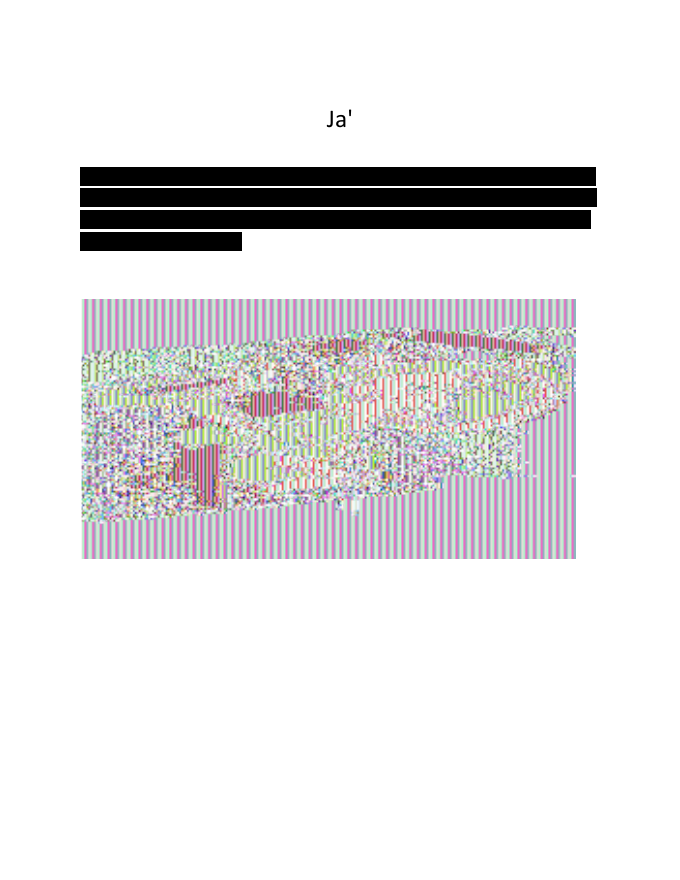
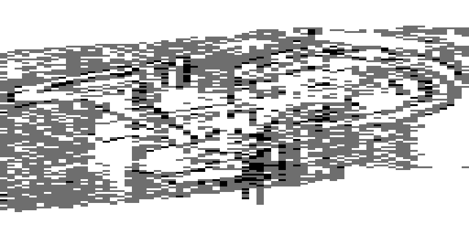

# Diagraphephobia — Writeup

**Category:** Forensics / Crypto
**Flag:** `spooky{qaStaH_nuq}`

> The Federation has found a redacted file from spying on the Klingon. They want to know the contents of it. Can you find it?

We get one file, `Diagraphephobia.pdf`. The name is a play on *diagraphephobia*, the fear of deleting things, which hints that something was never really removed.

---

## 1. First look

```console
$ file Diagraphephobia.pdf
Diagraphephobia.pdf: PDF document, version 1.4, 1 page(s)
```

When rendered, the page shows:

- the heading **`Ja'`**, which is Klingon for "tell" or "report"
- four lines of text covered by **black redaction bars**
- an image of colourful pink and green stripes and noise



## 2. The redaction is fake

The black bars are just filled rectangles drawn **over** the text. The text underneath is still in the page's content stream, so a plain text extraction recovers it:

```console
$ pdftotext -layout Diagraphephobia.pdf -
                               Ja'

B7o731QSZYJtbxIHjz045jhZoAhjG/MHqir4PZANSCWd75Jp/KGdAevRj2JOBEN3eME
W9Sto9ek0bGum9jXYPHiQ/3xQM8ZTrrB6a2OZJNAYCgFizrrNO4enzaXB2ZAGdN+fB
KQPPe530ZxrXlWBTV2QCyqJH8BmHGXKMU3XASpqaWeTXZzvhx1FJOkhV2pw2bif
mMo0Pk4i3XznS1UYsQ==
```

The decompressed content stream confirms it: four `re f` rectangles in black (`0 0 0 rg`) are drawn first, and then the text is laid out in the same area with `Tj`/`TJ`.

The text is base64. Decoding it gives **160 bytes** of high-entropy data. That's exactly 10 × 16 bytes, which points to a block cipher such as AES.

```console
$ base64 -d <<< 'B7o731QS...UYsQ==' > ct.bin
$ wc -c ct.bin
160 ct.bin
```

## 3. Finding the key: the metadata

The PDF has an incremental update appended after the first `%%EOF`. That update replaces the Info dictionary and the XMP metadata, and both contain a Klingon phrase:

```console
$ exiftool Diagraphephobia.pdf | grep -i -E 'subject|description'
Subject      : lojmIt yIpoSmoH!
Description  : lojmIt yIpoSmoH!
```

(`strings Diagraphephobia.pdf | grep Subject` shows the same thing.)

`lojmIt yIpoSmoH!` means **"Open the door!"**. It is exactly **16 characters**, the size of an AES‑128 key, so this is the key.

## 4. Finding the mode: the image is an ECB penguin

The noisy image is the hint for the cipher mode. Extract it with `pdfimages`:

```console
$ pdfimages -list Diagraphephobia.pdf
page   num  type   width height color comp bpc  enc ...
   1     0 image     256   134  icc     3   8  image ...
   1     1 smask     256   134  gray    1   8  image ...
```

It is a 256×134 RGB image with an alpha mask (the smask). Looking at the raw pixels, the background repeats every **4 pixels**:

```
(200,197,184) (165,252,201) (233,35,171) (113,170,176) (200,197,184) ...
```

The alpha channel repeats with the same period. Four RGBA pixels are 16 bytes, which is one AES block. The image was therefore encrypted with **AES in ECB mode**, where identical plaintext blocks always become identical ciphertext blocks. This is the classic "ECB penguin": the encryption hides the colours but not the shapes.

Dump both images with `pdfimages -png Diagraphephobia.pdf img`, which writes `img-000.png` (the colour data) and `img-001.png` (the alpha mask). If we split the RGBA data into 16-byte blocks and colour each block by how often it occurs, the picture shows up. The background is one block repeated about 3,500 times, and the outline of a starship hull appears against it, which fits the story of the decrypted message below.

```python
from PIL import Image
from collections import Counter

rgb = Image.open("img-000.png").convert("RGB")
a   = Image.open("img-001.png").convert("L")
raw = Image.merge("RGBA", (*rgb.split(), a)).tobytes()

blocks = [raw[i:i+16] for i in range(0, len(raw), 16)]
freq = Counter(blocks)
top = {b for b, _ in freq.most_common(6)}

W, H = 256 // 4, 134
out = Image.new("L", (W, H))
for i, b in enumerate(blocks):
    out.putpixel((i % W, i // W), 255 if b in top else (0 if freq[b] == 1 else 110))
out.resize((768, 402), Image.NEAREST).save("ecb_view.png")
```



(The image was encrypted with a different key than the text. The text key does not decrypt it, and we don't need to: the image only tells us the mode.)

## 5. Decrypt

AES‑128‑ECB, key `lojmIt yIpoSmoH!`, no IV:

```console
$ openssl enc -d -aes-128-ecb -K $(printf 'lojmIt yIpoSmoH!' | xxd -p) -in ct.bin
nuqneH
DaHjaj tlhIngan yotlh botlhDaq DIvI' Duj wItu'. Heghlaw' 'ej lonlu'law'. Duj wIHuD 'ej Hov leng peghmey wItu'laH 'e' wItlhoblI'.

spooky{qaStaH_nuq}
```

The plaintext uses PKCS#7 padding (`03 03 03`), which openssl removes by default.

Rough translation of the Klingon:

> *Greetings. Today we found a Federation ship in the middle of Klingon territory. Its crew seems dead and the ship abandoned. We will raise the ship, and we hope to find its secrets of interstellar travel.*

## Flag

```
spooky{qaStaH_nuq}
```

`qaStaH nuq` is Klingon for **"What's going on?"**

---

## One-shot solve

```bash
#!/usr/bin/env bash
pdf=Diagraphephobia.pdf
key=$(strings "$pdf" | grep -ao 'Subject([^)]*)' | sed 's/^Subject(//; s/)$//')
pdftotext "$pdf" - | grep -E '^[A-Za-z0-9+/=]{8,}$' | tr -d '\n' | base64 -d |
  openssl enc -d -aes-128-ecb -K "$(printf '%s' "$key" | xxd -p)"
```

## Takeaways

- **Redaction ≠ deletion.** A black box drawn over text leaves the text in the file. Proper redaction removes the content from the content stream.
- **Check the metadata**, including incremental updates appended after the first `%%EOF`.
- **ECB leaks structure.** Repeated blocks show patterns in the plaintext. A periodic pattern whose period matches the cipher's block size is a strong sign of ECB mode.
